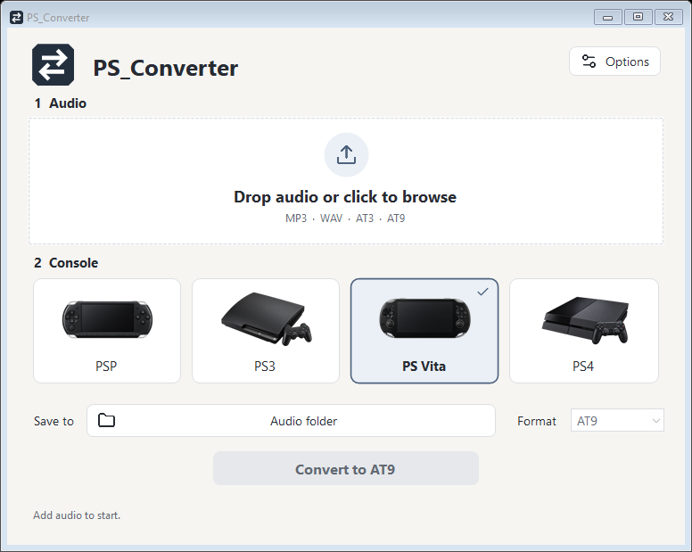
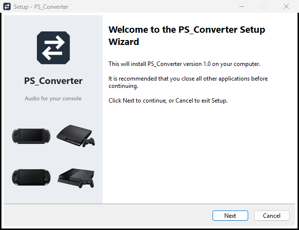
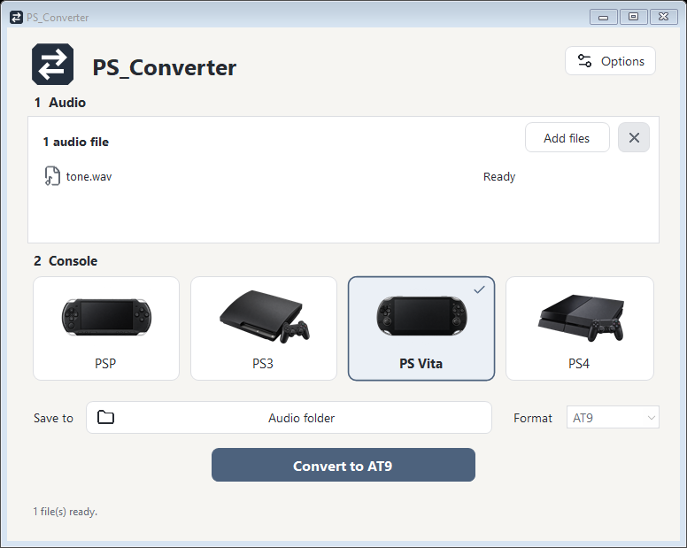
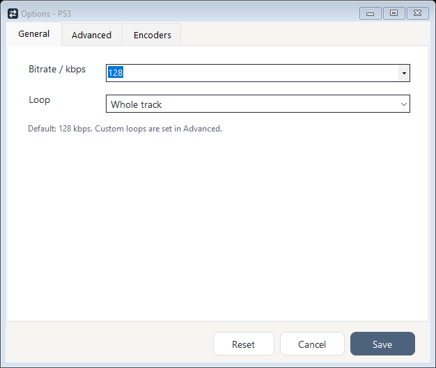

<p align="center">
  
</p>
<h1 align="center">PS_Converter</h1>
<p align="center">Audio conversion for PSP, PS3, PS Vita and PS4.<br>Drop your audio. Choose a console. Convert.</p>
<p align="center">
  <a href="https://github.com/jotadev27/PS_Converter/releases/tag/v1.0">Download v1.0</a> ·
  <a href="docs/QUICKSTART.md">Quick start</a> ·
  <a href="docs/THIRD_PARTY.md">Third-party notices</a> ·
  <a href="LICENSE">MIT license</a>
</p>



## Get started

| Download | How to use it |
|---|---|
| **Windows installer** | Open `PS_Converter-v1.0-setup.exe`, accept the license terms, choose an empty folder and click Install. |
| **Portable ZIP** | Extract **all** files from `PS_Converter-v1.0-portable.zip`, then double-click `PS_converter.exe`. Keep the `codecs` folder beside it. |

Release downloads include the application and its codec files. **No repository clone is needed to run them.** Windows 10/11, .NET Framework 4.8 and Windows Media Foundation are required. Windows N editions need the Media Feature Pack. App-local x86 codec runtimes are included; no system-wide runtime installation is performed.

<details>
<summary>Preview the English installer</summary>



</details>

The source repository excludes third-party executables and release artifacts. Native codec redistribution terms remain unresolved; see [licensing scope](#licensing) before publishing binary downloads.

## Three steps

1. **Add audio** — drag MP3/WAV files into the window or click Add files.
2. **Choose a console** — PSP, PS3, PS Vita or PS4.
3. **Convert** — outputs are saved beside your audio unless you choose another folder.



| Console | Encoded format | Default bitrate |
|---|---|---|
| PSP | AT3 | 132 kbps |
| PS3 | AT3 | 128 kbps |
| PS Vita | AT9 | 144 kbps |
| PS4 | AT9 | 144 kbps |

AT3/AT9 inputs can also be decoded to WAV or MP3. Select the console that matches the encoded input. The conversion algorithms are provided by separate native codec tools; the C# application handles the queue, Windows audio normalization, validated arguments and output publication.

## Options without clutter

Bitrate and looping are under General. Advanced holds the codec-specific controls. Normal release use needs no executable picker; Encoders is available for an explicit custom override.



- Batch conversion and cancellation.
- Existing files preserved; colliding names get a numbered suffix.
- No artificial file-count, duration or usage limits. Real format, storage and codec limits still apply.
- Local processing, with no telemetry, updater or automatic downloads in the app.

[Read the complete quick start →](docs/QUICKSTART.md)

## Build from source

The application and tests are **C# / .NET Framework 4.8**. Build scripts are PowerShell. No Python, NuGet restore or automatic dependency installation is used.

```powershell
git clone https://github.com/jotadev27/PS_Converter.git
cd PS_Converter
.\build.ps1 -SourceOnly -Verify -PortableName SourceBuild
```

This builds the application and runs the synthetic regression suite without downloading or bundling native codecs. Three real codec-inventory checks are explicitly skipped in source-only mode. Conversion requires separately supplied compatible codec files; a source build is not a complete portable release.

To build the complete local release, supply the authorized codec/runtime inputs described in [the release guide](docs/RELEASING.md), then run:

```powershell
.\build.ps1 -Verify -Package -PortableName Release
```

The `installer` folder is ignored by Git. It holds the installer, portable ZIP, SHA-256 checksum file and GitHub release text. No generated package, private configuration, cache or test audio belongs in a source commit.

## Files and verification

Settings stay in `data/settings.json` beside the app. Conversion intermediates remain in `.psconverter-work` under the output folder; remove them manually when no longer needed.

The visual update preserves the conversion/core source files. Verification covers synthetic conversion routes, real Windows decoding/resampling, native UI layout, codec identity checks and installer/portable extraction. Native Vita and PS4 round trips pass with generated audio and the packaged runtimes; PSP/PS3 retain a pre-existing sandbox loader restriction. Physical consoles and a pristine Windows installation have not been tested. See [verification details](docs/VERIFICATION.md).

## Licensing

Copyright © 2026 **jotadev27**. PS_Converter source code is available under the [MIT license](LICENSE).

Lucide icons retain their [upstream notices](assets/icons/LICENSE.txt). Microsoft runtimes and native ATRAC/MP3 tools retain their separate terms and ownership; **MIT does not license those binaries**. Their redistribution requirements must be confirmed before uploading binary release assets. The local packages are preparation artifacts, not a declaration that third-party redistribution is cleared. See [third-party notices](docs/THIRD_PARTY.md).
